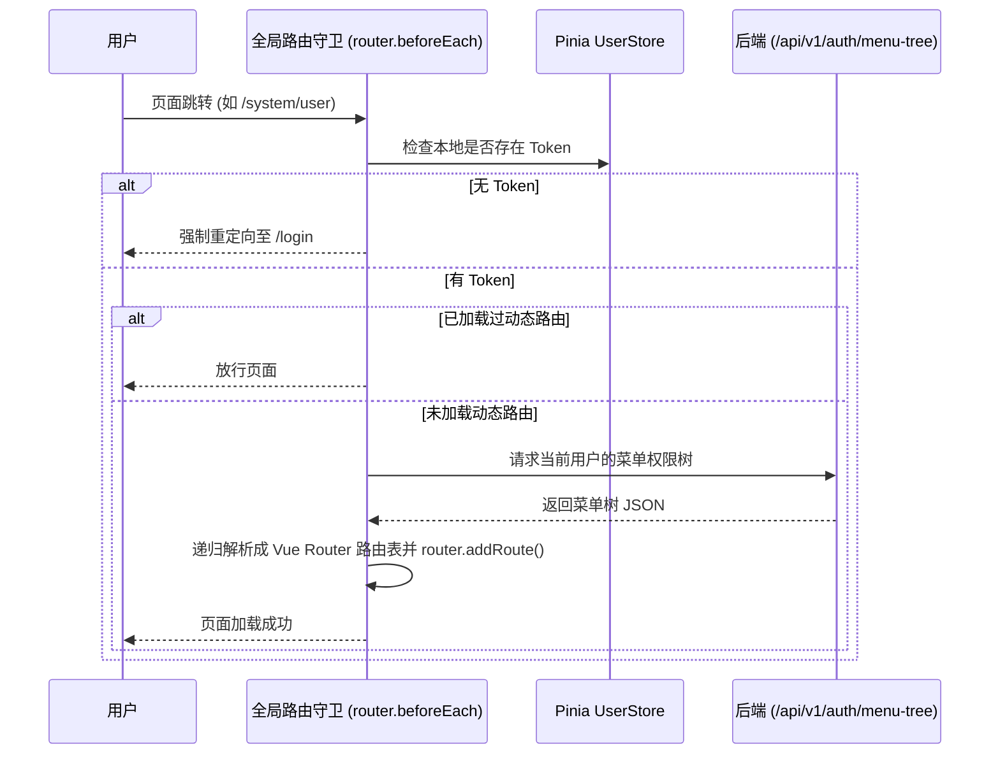

# 企业级通用前端架构设计与规范文档 (Frontend Architecture Document)

本文档旨在为企业级通用前后端基座脚手架（Base Framework）定义前端架构设计、技术选型、目录结构、TS类型规范与核心红线。

---

## 1. 核心技术栈与环境版本标准

| 维度 | 技术选型 | 说明 |
| :--- | :--- | :--- |
| **运行时环境** | **Node.js 24 LTS** | 官方最新 Active LTS 长期支持版，具备最高构建性能与稳定性。 |
| **包管理器** | **pnpm 9.x+** | 高效全局缓存，依赖安装速度提升3倍，彻底避免依赖污染。 |
| **核心框架** | **Vue 3.5+** | 最新官方正式版，全面采用 `<script setup>` 组合式 API 语法。 |
| **构建工具** | **Vite 6+** | 下一代极速前端构建工具，毫秒级热重载、Gzip 预压缩与 Rollup 分包。 |
| **开发语言** | **TypeScript 5.x** | 强类型模式（开启 `noImplicitAny` 与 `strictNullChecks`），100% 覆盖 API 出入参类型，彻底规避 `undefined` 错误。 |
| **UI 组件库** | **Element Plus 2.8+** | 现代化企业级后台组件库，配置 `unplugin-vue-components` 自动按需导入。 |
| **状态管理** | **Pinia 3.x** | Vue 官方推荐的状态层，配置 `pinia-plugin-persistedstate` 自动持久化。 |
| **路由管理** | **Vue Router 4.x** | **HTML5 History 模式** (`createWebHistory`)，配合后端菜单树实现 100% 纯动态路由挂载。 |
| **HTTP 客户端**| **Axios 1.7+** | 二次封装网络请求层，自动拦截 Token、自动解包 `Result<T>`、全局错误弹窗与 Blob 流式下载。 |

---

## 2. 工程目录结构与职责划分 (对齐 `frontend-vue-standards`)

采用清爽、强类型、组件化的标准目录结构：

```text
agy-front/
 ├── public/                      # 静态资源 (favicon, logo, 静态地图配置文件)
 ├── src/
 │    ├── api/                    # 📂 HTTP 接口层 (按业务模块划分)
 │    │    ├── modules/           # 业务 API 声明 (authApi.ts, userApi.ts)
 │    │    └── types/             # API 强类型接口定义 (userModel.ts, commonModel.ts)
 │    │
 │    ├── assets/                 # 📂 静态资源 (图片、SVG 图标、全局样式)
 │    │    ├── icons/             # 矢量 SVG 图标目录 (user.svg, role.svg)
 │    │    └── styles/            # 全局样式 (variables.scss, element-cover.scss)
 │    │
 │    ├── components/             # 📂 全局公共组件 (大驼峰目录结构，如 UserCard/index.vue)
 │    │    ├── DictTag/           # 动态字典展示组件
 │    │    ├── Pagination/        # 通用分页组件
 │    │    └── SvgIcon/           # SVG 图标渲染组件 (vite-plugin-svg-icons)
 │    │
 │    ├── directive/              # 📂 自定义Vue指令
 │    │    └── permission.ts      # 按钮级别权限指令 v-permission
 │    │
 │    ├── layout/                 # 📂 核心布局组件
 │    │    ├── MainLayout.vue     # 主框架布局 (顶部 Header + 侧边栏 Sidebar + Tabs 页签 + 面包屑 + 全局水印)
 │    │    └── components/        # 布局子组件 (Header.vue, Sidebar.vue, AppMain.vue, TagsView.vue)
 │    │
 │    ├── router/                 # 📂 路由配置中心
 │    │    ├── index.ts           # 路由实例构建 (HTML5 History 模式)
 │    │    ├── routes.ts          # 基础静态路由 (登录页, 404, 首页)
 │    │    └── permission.ts      # 全局路由守卫 (Token 拦截、动态路由生成)
 │    │
 │    ├── stores/                 # 📂 Pinia 状态管理
 │    │    ├── user.ts            # 当前登录用户状态 (Token, 角色, 权限, UserInfo)
 │    │    ├── permission.ts      # 动态路由菜单状态
 │    │    └── app.ts             # 应用配置状态 (侧边栏折叠, 多页签, KeepAlive 缓存)
 │    │
 │    ├── utils/                  # 📂 工具库
 │    │    ├── request.ts         # Axios 核心封装 (请求/响应拦截器, 错误自动提示)
 │    │    ├── download.ts        # EasyExcel 二进制 Blob 流式文件下载工具
 │    │    └── storage.ts         # 本地存储工具 (LocalStorage / SessionStorage)
 │    │
 │    ├── views/                  # 📂 页面视图目录 (小驼峰，如 userManage/)
 │    │    ├── login/index.vue    # 高颜值自定义登录页
 │    │    ├── dashboard/index.vue# 控制台/首页
 │    │    └── userManage/        # 用户管理页面
 │    │         ├── index.vue     # 主视图
 │    │         └── components/   # 页面私有复用组件 (大驼峰，如 UserEditModal.vue)
 │    │
 │    ├── App.vue                 # 应用程序根组件
 │    ├── main.ts                 # 前端唯一入口文件 (含全局异常捕获与 Pinia 持久化)
 │    └── vite-env.d.ts           # TypeScript 环境声明文件
 │
 ├── .env.development             # 开发环境变量 (API 代理地址)
 ├── .env.production              # 生产环境变量
 ├── index.html                   # HTML 入口模板
 ├── package.json                 # 工程依赖与脚本
 ├── tsconfig.json                # TypeScript 编译配置文件
 └── vite.config.ts               # Vite 构建配置文件
```

---

## 3. 核心红线守则 (Core Red Lines)

1. **绝对禁止全盘使用 `any`（TS 覆盖率 100%）**：
   所有调用后端接口的请求参数 (`DTO`) 和响应返回值 (`VO`) 必须在 `src/api/types/` 中编写 TypeScript `interface` / `type`。`tsconfig.json` 强行开启 `"noImplicitAny": true` 与 `"strictNullChecks": true`。
2. **三段式响应 `Result<T>` 自动拦截解包**：
   在 `request.ts` 响应拦截器中统一处理：
   * `code === 0`：自动提取 `response.data.data` 直接返回给业务代码；
   * `code !== 0`：自动触发 `ElMessage.error(message)` 弹窗，业务代码无需重复写错误弹窗逻辑。
3. **遭遇 401 自动清除状态并重定向**：
   当 Axios 捕获到后端返回 `401 Unauthorized` 时，必须自动触发 `userStore.resetToken()`，清理本地 Token 缓存，并重定向跳转至 `/login` 登录页。
4. **强语义与严禁拼音命名**：
   * 组件目录/文件：大驼峰（PascalCase，如 `UserCard/index.vue`、`UserEditModal.vue`）；
   * 普通目录/文件：小驼峰（camelCase，如 `userManage/`）；
   * 全局公共组件放在 `src/components/组件名/index.vue`，页面私有组件放在 `src/views/模块/components/组件名.vue`；
   * **绝对禁止使用拼音进行变量、方法或文件命名**。
5. **绝对禁止在 URL 中拼接敏感明文**：
   密码、身份证等敏感字段绝对禁止拼接在 GET URL 中传输，必须放在 POST Body 中传输。

---

## 4. 核心规范设计细节

### 4.1 Axios 网络请求层封装 (`src/utils/request.ts`)

```typescript
import axios from 'axios';
import { ElMessage } from 'element-plus';
import { useUserStore } from '@/stores/user';

// 创建 Axios 实例
const service = axios.create({
  baseURL: import.meta.env.VITE_APP_BASE_API || '',
  timeout: 15000,
});

// 请求拦截器
service.interceptors.request.use(
  (config) => {
    const userStore = useUserStore();
    if (userStore.token) {
      // 自动注入 Opaque 32位 UUID Token
      config.headers['Authorization'] = `Bearer ${userStore.token}`;
    }
    return config;
  },
  (error) => Promise.reject(error)
);

// 响应拦截器
service.interceptors.response.use(
  (response) => {
    const res = response.data;
    // 如果是二进制流（如 EasyExcel 文件导出），直接返回
    if (response.config.responseType === 'blob') {
      return response.data;
    }
    // 判断后端标准三段式 Result code
    if (res.code === 0) {
      return res.data; // 直接解包提纯返回 data
    } else {
      ElMessage.error(res.message || '系统业务处理异常');
      return Promise.reject(new Error(res.message || 'Error'));
    }
  },
  (error) => {
    if (error.response && error.response.status === 401) {
      const userStore = useUserStore();
      userStore.resetToken();
      location.href = '/login';
    } else {
      ElMessage.error(error.message || '网络连接异常，请稍后重试');
    }
    return Promise.reject(error);
  }
);

export default service;
```

---

### 4.2 TypeScript 严格配置与指标红线 (`tsconfig.json`)

在 `tsconfig.json` 中强指定：
```json
{
  "compilerOptions": {
    "noImplicitAny": true,
    "strictNullChecks": true
  }
}
```

| 目标层级 | TS 覆盖率红线 | 校验细则 |
| :--- | :---: | :--- |
| **API 调用定义** | **100%** | `api/` 目录下所有接口函数，其入参 DTO、出参 VO 必须声明完整类型，严禁 `any`。 |
| **核心业务接口** | **100%** | 涉及审批、用户、权限与核心业务的 API，响应类型必须声明 TS 接口。 |
| **全局数据结构** | **$\ge 80\%$** | Pinia 全局状态与共享数据模型，均需在 `src/api/types/` 统一定义。 |

---

### 4.3 全局未捕获异常监听 (`main.ts`)

在生产环境下，拦截未捕获的 Vue 渲染错误与 Promise Reject 异常，防止页面白屏：

```typescript
app.config.errorHandler = (err, instance, info) => {
  console.error('Vue 全局异常拦截:', err, info);
  if (import.meta.env.PROD) {
    ElMessage.error('系统繁忙，请稍后再试');
  }
};

window.onunhandledrejection = (event) => {
  console.error('未处理的 Promise 拒绝:', event.reason);
};
```

---

### 4.4 动态路由与导航守卫流程 (`src/router/permission.ts`)

采用 **100% 纯后端控制的动态路由机制**：



---

### 4.5 按钮级别权限控制指令 (`v-permission`)

在 `src/directive/permission.ts` 定义全局自定义指令：

```html
<!-- 必须拥有 sys:user:add 权限按钮才渲染 -->
<el-button v-permission="['sys:user:add']" type="primary">新增用户</el-button>

<!-- 导出按钮权限控制 -->
<el-button v-permission="['sys:user:export']" type="success">导出 Excel</el-button>
```

---

### 4.6 Nginx 生产环境部署标准配置

生产环境支持 **HTML5 History 模式 (`createWebHistory`)**，Nginx 配置如下：

```nginx
server {
    listen       80;
    server_name  localhost;

    # 前端静态资源托管
    location / {
        root   /usr/share/nginx/html;
        index  index.html index.htm;
        # 核心：支持 HTML5 History 模式，刷新不报 404
        try_files $uri $uri/ /index.html;
    }

    # 后端 API 反向代理
    location /api/ {
        proxy_pass http://127.0.0.1:8080/;
        proxy_set_header Host $host;
        proxy_set_header X-Real-IP $remote_addr;
        proxy_set_header X-Forwarded-For $proxy_add_x_forwarded_for;
    }
}
```

---

### 4.7 Pinia 状态自动持久化 (`pinia-plugin-persistedstate`)

配置 `userStore` 的 Token 和用户基础信息自动同步绑定 `localStorage`：
* 用户按 F5 页面刷新时，Token 与用户登录状态不会被重置清空；
* 用户点击【退出登录】时，自动销毁本地持久化数据。

---

### 4.8 搭配后端 EasyExcel 的二进制 Blob 文件流下载工具 (`src/utils/download.ts`)

通用文件流下载封装，防止页面重复点击与内存卡顿：

```typescript
import { ElLoading, ElMessage } from 'element-plus';

export function downloadBlobFile(data: Blob, defaultFilename: string) {
  const loading = ElLoading.service({ text: '正在导出数据，请稍候...', background: 'rgba(0, 0, 0, 0.7)' });
  try {
    const blob = new Blob([data], { type: 'application/vnd.openxmlformats-officedocument.spreadsheetml.sheet' });
    const url = window.URL.createObjectURL(blob);
    const link = document.createElement('a');
    link.href = url;
    link.download = defaultFilename;
    document.body.appendChild(link);
    link.click();
    document.body.removeChild(link);
    window.URL.revokeObjectURL(url);
  } catch (error) {
    ElMessage.error('文件导出失败');
  } finally {
    loading.close();
  }
}
```

---

### 4.9 多页签 Tabs 视图与页面缓存 (`TagsView` + `<keep-alive>`)

在 `src/layout/components/TagsView.vue` 与 `AppMain.vue` 配置多页签导航：
* 用户在侧边栏切换路由时，顶部展示打开的页面页签（如 `[控制台] [用户管理]`）；
* 结合 Vue 3 `<keep-alive :include="cachedViews">` 实现页面输入框与筛选条件的开箱即用状态保留。

---

### 4.10 Vite 6 生产环境 Rollup 分包与 Gzip 预压缩优化 (`vite.config.ts`)

为解决前端单页面大文件打包首屏加载慢的痛点，在 `vite.config.ts` 配置分包拆分：

```typescript
import { defineConfig } from 'vite';
import vue from '@vitejs/plugin-vue';
import viteCompression from 'vite-plugin-compression';

export default defineConfig({
  plugins: [
    vue(),
    // 生产构建开启 Gzip 预压缩
    viteCompression({ verbose: true, disable: false, threshold: 10240, algorithm: 'gzip', ext: '.gz' }),
  ],
  build: {
    rollupOptions: {
      output: {
        // 大第三方库分包拆分，提升首屏加载速度
        manualChunks: {
          'vue-vendor': ['vue', 'vue-router', 'pinia'],
          'element-plus': ['element-plus'],
          'echarts': ['echarts'],
        },
      },
    },
  },
});
```

---

### 4.11 Element Plus 组件与图标按需自动导入 (`unplugin-vue-components`)

在 `vite.config.ts` 集成 `unplugin-vue-components` 和 `unplugin-auto-import`：
* 开发时无需在代码中手动 `import { ElButton } from 'element-plus'`；
* 模板中直接写 `<el-button>`，Vite 自动按需编译引入样式与代码，**打包产物减少 60% 体积**！

---

### 4.12 通用输入防抖与高频事件节流 (`lodash-es`)

在 `src/utils/` 中封装防抖与节流：
* 输入框搜索查询使用 `debounce(fn, 300)`，防止输入一个字就向后端发一次请求；
* 窗口 resize 与页面滚动使用 `throttle(fn, 200)`，防止高频触发导致 UI 卡顿。

---

### 4.13 SVG 矢量图标自动精灵图打包 (`vite-plugin-svg-icons`)

在 `src/assets/icons/` 统一管理自定义 SVG 矢量图标：
* 集成 `vite-plugin-svg-icons` 插件，启动时自动将目录下所有 SVG 打包编译为 Sprite 精灵图；
* 全局提供 `<svg-icon icon-class="user" />` 高效渲染组件，零 HTTP 额外请求开销。

---

### 4.14 全局政企级安全防泄露动态水印 (`<el-watermark />`)

在 `MainLayout.vue` 的最外层包装 Element Plus 的动态水印：
```html
<el-watermark :content="[userStore.realName, userStore.mobileLastFour]">
  <router-view />
</el-watermark>
```
* **效果**：系统全页面自动悬浮当前登录人姓名与手机号末 4 位淡色倾斜水印，**有效防范截图泄露风险**，符合政企网络安全安评标准！

---

## 5. 前后端对接流程示范（极简开发流）

以“用户管理页面”为例，Java 程序员的前端开发只需 3 步：

1. **定义 TS 强类型接口** (`src/api/types/userModel.ts`)：
   ```typescript
   export interface SysUserVO {
     id: string;
     username: string;
     realName: string;
     mobile: string;
     status: number;
     statusDictText: string;
   }
   ```
2. **定义 API 方法** (`src/api/modules/userApi.ts`)：
   ```typescript
   import request from '@/utils/request';
   import type { SysUserVO, PageQueryDTO, PageResultVO } from '../types/userModel';

   export function getUserPageApi(params: PageQueryDTO) {
     return request.get<any, PageResultVO<SysUserVO>>('/api/v1/users', { params });
   }
   ```
3. **在页面使用** (`src/views/userManage/index.vue`)：
   ```typescript
   const userList = ref<SysUserVO[]>([]);
   const loadData = async () => {
     // 自动解包获得强类型数组，带完整智能提示！
     const res = await getUserPageApi({ pageNo: 1, pageSize: 10 });
     userList.value = res.records;
   };
   ```

简单、清晰、规避语法与类型报错风险！
